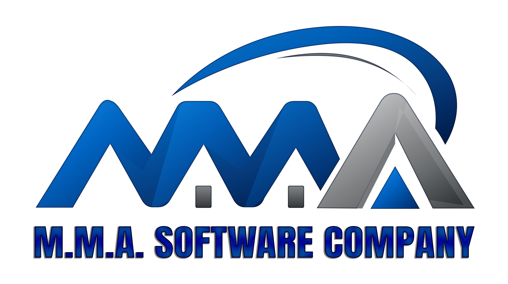

   

<h1 align="center">M.M.A. Software Company</h1>

<h3 align="center">Independent Software Development & Solutions</h3>

 

## About

M.M.A. Software Company is the personal software identity representing the development projects and programming work of Mostapha Mahmoud Abd El-Salam.

## Our Software

A selection of software systems and applications developed over the years:

1. **Human Resources Management Systems (HR)** – Employee records and personnel management.
2. **Hotel Reservation Systems** – Hotel bookings and reservation management.
3. **Nutrition Management Systems** – General, clinical, sports, hospital, pediatric, infant, and specialized nutrition management.
4. **Accounting Systems** – Inventory, customers, suppliers, sales, purchases, loans, fixed assets, petty cash, and more.
5. **Animal Production Management Systems** – Rabbit Farm Management and Ostrich Egg Incubation Laboratory Management.
6. **Sports & Social Club Membership Systems** – Membership cards and club member management.
7. **Schools & Higher Education Management Systems** – Student attendance, academic subjects, examinations, examination control, and more.
8. **M.M.A. Reports** – A comprehensive reporting system integrating Engine, Designer, Viewer, and Script Editor.

## Our Next Direction

Our upcoming development efforts will focus more extensively on creating specialized tools for software developers, including:

- **Report Tools:** Advanced reporting engines and design environments.
- **Form Tools:** Flexible form design and development solutions.
- **Controls:** Reusable programming controls and components.
- **Developer Libraries:** General-purpose libraries and utilities that simplify software development.

## About the Author / Developer

**Mostapha Mahmoud Abd El-Salam**  
*Systems Analyst and Software Developer.*

He is also the founder and owner of:

- **Moktashefun:** A company specializing in Documentary, Knowledge, Metaverse, and Software Production.
- **EGASS:** Egyptian Foundation for the Simplification of Science.
- **Egyptian Geographic:** Founder of the scientific, documentary, and knowledge-based magazine and its website.

## Our Philosophy

Creating software is not just about developing applications; it is about transforming ideas into practical tools, solving real-world problems, and continuously improving the way people work.

## Contact & Official Pages

**Phone:** [Add Phone Number]

**Official Pages:**

- **Mostapha Mahmoud Abd El-Salam:** [Official Facebook Page](https://www.facebook.com/mostaphaabdelsalam/)
- **Egyptian Geographic:** [Official Magazine Facebook Page](https://www.facebook.com/Geographic.Egn)
- **M.M.A. Reports:** [Official Software Facebook Page](https://www.facebook.com/profile.php?id=61595658903074)

---

**M.M.A. Software Company**

*Driven by Ideas. Built with Passion. Powered by Code.*
